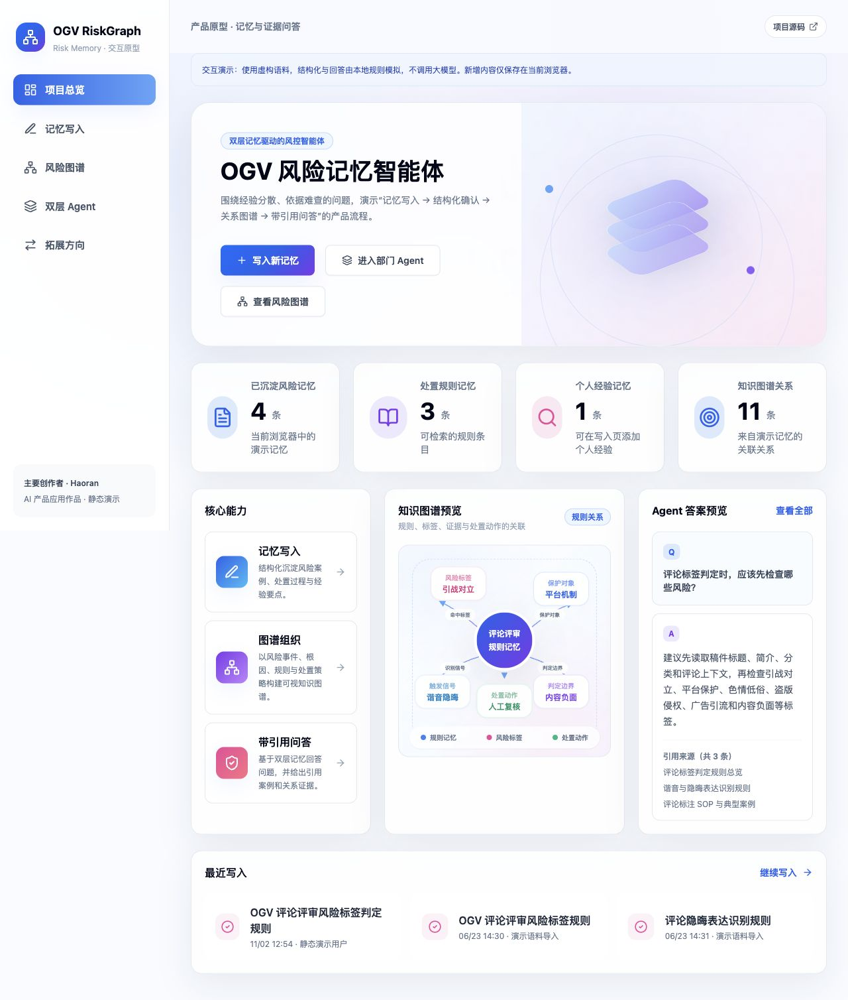
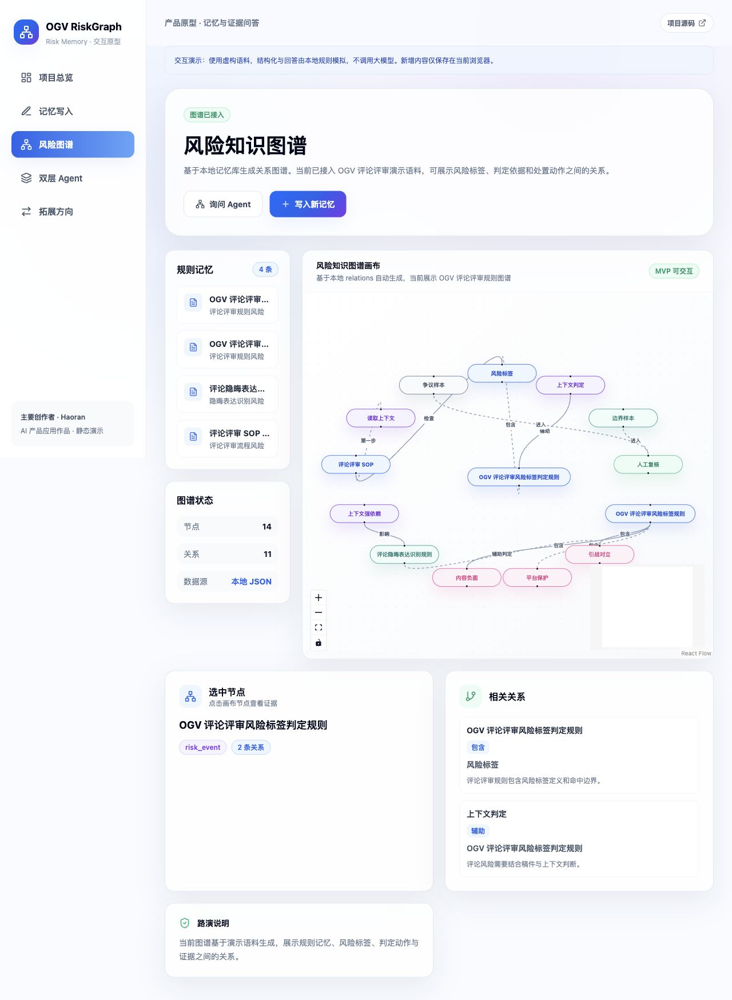
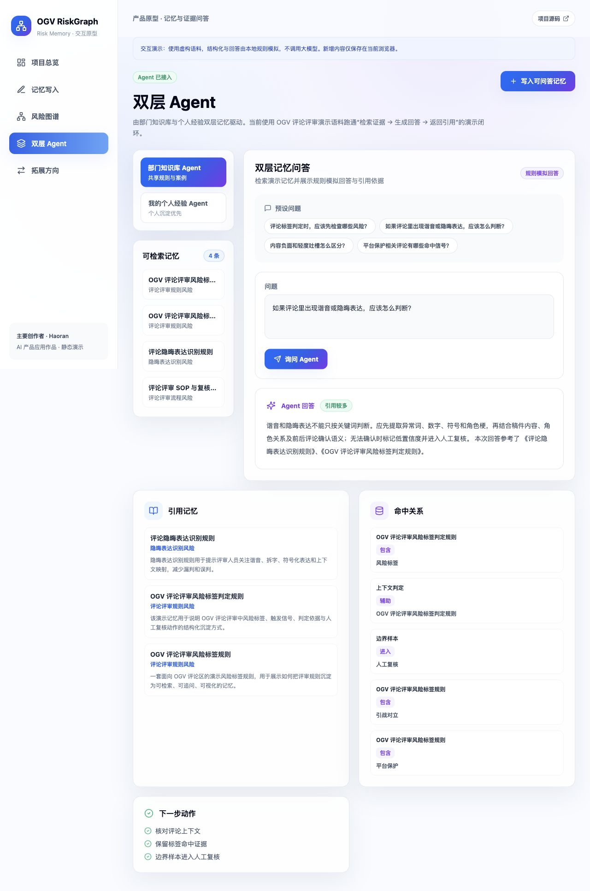

# OGV RiskGraph Static Demo

OGV RiskGraph 的纯前端静态演示版，用于通过 GitHub Pages 展示风险记忆写入、结构化确认、知识图谱和双层 Agent 问答流程。

**[打开在线交互演示](https://liu122099.github.io/ogv-riskgraph-static-demo/)**

## 项目简介

主要创作者：Haoran。面向 AI 产品经理 / 产品经理求职展示，围绕“经验分散、依据难查”的问题，设计从记忆写入到证据问答的交互流程。

**建议体验顺序**：总览 → 记忆写入（自带示例）→ 结构化确认 → 保存到本地 → 图谱 → 双层 Agent 预设问答。

这是交互原型，结构化字段和回答由浏览器规则与模板生成，不调用真实大模型，不代表线上风控系统或真实效果评测。页面统计来自当前演示数据，不展示虚构命中率与增长成绩。

## 界面预览

以下为本次静态演示的实际页面截图，包含写入一条虚构案例后的本地状态；统计数字仅表示演示数据，不是业务成绩。

### 项目总览



### 风险知识图谱



### 带引用问答



## 演示能力

- Dashboard 风险记忆统计与关系预览
- 评论评审演示规则和案例
- 记忆写入与本地结构化确认
- 可交互风险知识图谱
- 基于本地证据的 Agent 问答
- 新写入内容保存到浏览器 `localStorage`

## 静态版说明

本仓库不包含服务端 API、数据库和模型密钥。所有数据均为编造的演示语料，Agent 回答和结构化结果由浏览器端演示逻辑生成。

浏览器本地新增的数据不会上传到服务器。清理站点数据或更换浏览器后，本地新增内容会消失。

完整动态版本与本静态仓库相互独立。

## 本地运行

环境要求：

- Node.js `22.13+`，建议使用 Node.js 24
- pnpm 11.x

```bash
pnpm install
pnpm dev
```

访问：

```text
http://127.0.0.1:3000
```

## 静态构建

```bash
pnpm lint
pnpm build
```

构建产物位于 `out/`。推送到 `main` 后，GitHub Actions 会自动构建并部署到 GitHub Pages。
